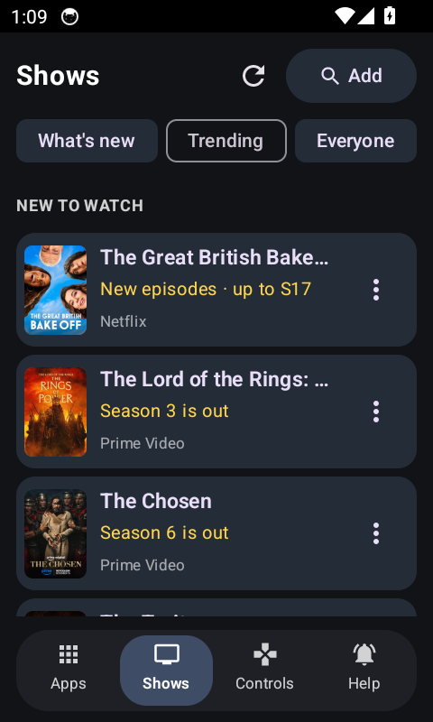
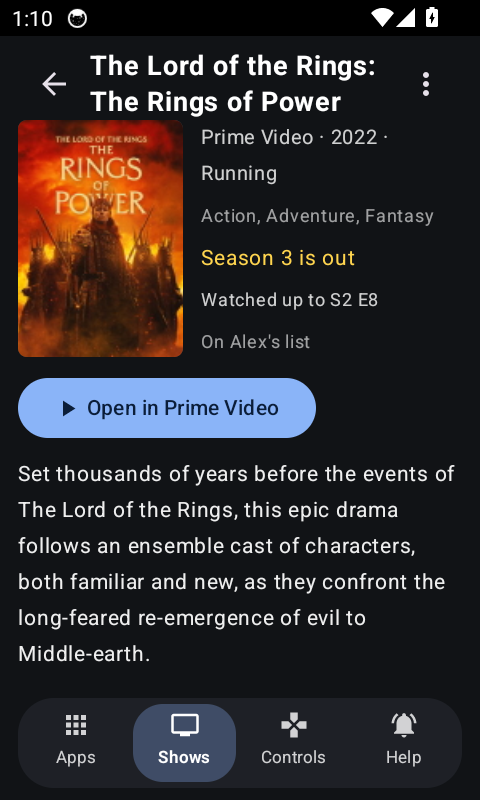
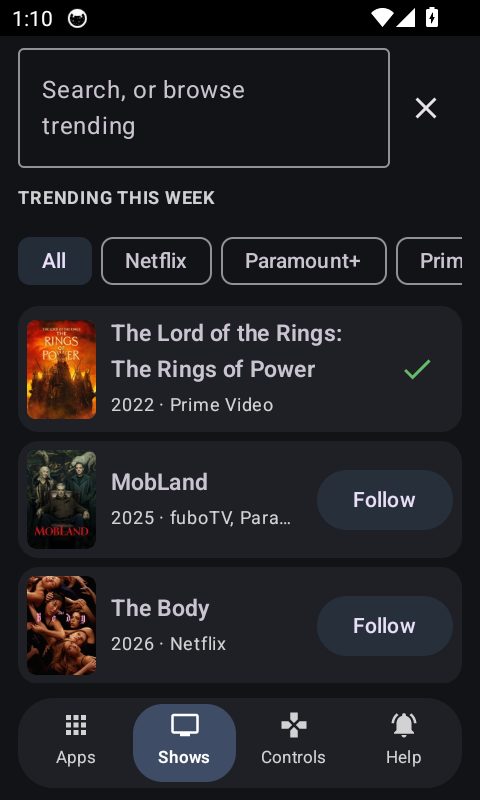
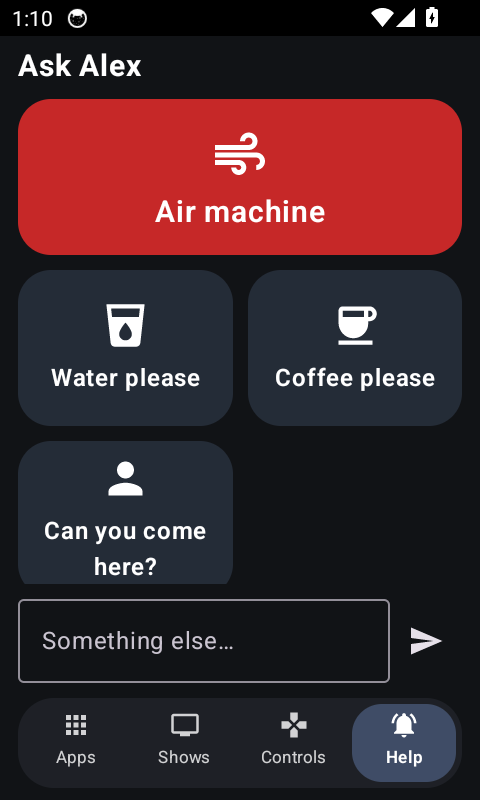
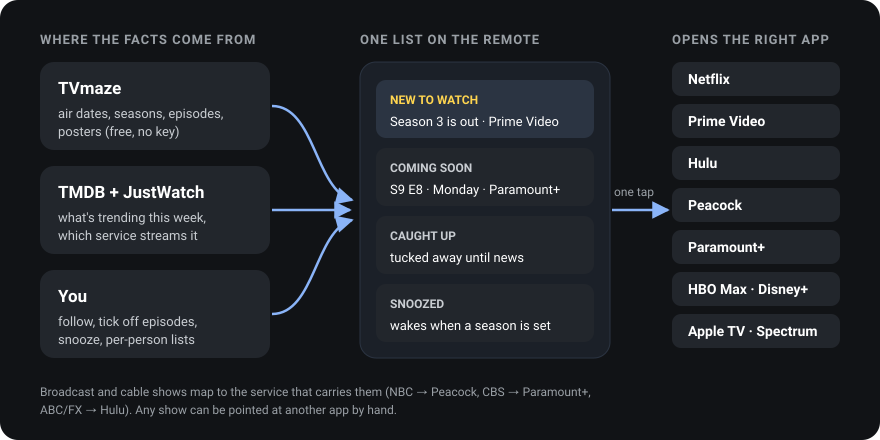

# Clicker

A small, open-source remote-control app for Android touchscreen remotes, built first for the
**Haptique RS90** (Android 12) as an alternative to its stock app. It runs on any Android 8+
device; IR needs a device with an IR emitter.

**New to this? Start with the [RS90 setup guide](docs/setup-rs90.md).**

<p align="center">
  
</p>

<p align="center">
  
  
  
  
</p>

<p align="center"></p>

Screenshots use demo data on an emulator sized like the RS90 (480×800).

It talks to devices directly on your network. The remote control part needs no cloud account
and no server; the optional show tracking and help alerts use the online services named below.

| Device | How | What works |
|---|---|---|
| **Apple TV** (tvOS 15+) | Wi-Fi, Companion protocol (same as Apple's Remote app) | arrows, select, back, home, play/pause, volume via HDMI-CEC, wake/sleep, open apps by name |
| **LG webOS TV** (2018+) | Wi-Fi, SSAP WebSocket, with IR fallback | power off, volume, mute, arrows/OK/back/home, open apps |
| **LG TV** | IR (NEC) | power on/off, volume, input, navigation |
| **Denon soundbar** | IR (Kaseikyo), *experimental* | power, volume, mute |

The RS90's hardware keys (arrows, select, back, menu, volume, mute, play/pause, page up/down)
are mapped too. Settings has a key tester to identify other keys.

## Screens

The bottom bar switches between four pages; the gear opens Settings.

- **Apps**: choose Apple TV or LG TV at the top (the dot shows the connection), On/Off for
  everything, Input, and app tiles with their artwork (Apple TV, Netflix, Prime Video, YouTube,
  Hulu, Peacock, Paramount+, HBO Max, Disney+).
- **Shows**: the shows you follow, grouped as *New to watch*, *Coming soon*, *Caught up*,
  *Finished* and *Snoozed*. *What's new* hides shows with nothing new; they come back by
  themselves when an episode airs or a season gets a date. Lists can be per person. Tap a show
  for its details: summary, new episodes (tick them off), the next air date, and **Open show**.
  That opens the show's page in the Apple TV app (found through Wikidata), or an Apple TV search
  for it, and Play there starts it in Hulu, Peacock, Prime Video and so on. Netflix ignores
  links from outside, so Netflix shows open the Netflix app. *Add* searches, or shows what's trending this week across services.
- **Controls**: D-pad, Back / Home / Play, and press-and-hold volume.
- **Help**: big buttons ("Water please", "Coffee please", …) that send an alert to someone's
  phone until they acknowledge it, then show "seen at 2:41" on the remote. One tap starts a
  3-second countdown with Cancel. Urgent requests (a line starting with `!`, such as
  `!Air machine`) get a full-width red button, a siren sound and longer repeats.
- **Settings** (gear): find and pair devices, what the volume buttons control, the TMDB token,
  help alert keys and buttons, show list backup and restore, IR tests, the key tester, and an
  optional personal background.

## Related projects

- [Harmonium](https://github.com/skavan/harmonium): fast Home Assistant dashboards for low-power
  Android remotes, including the RS90. A good fit if your home already runs Home Assistant.
- [haptique_rs90](https://github.com/daangel27/haptique_rs90): a Home Assistant integration for
  the RS90's stock software over MQTT.

Clicker takes a different route: a native app that talks to the TV and Apple TV directly, with
no Home Assistant or hub required.

## Build and install

Not a developer? Skip this and follow the [setup guide](docs/setup-rs90.md).

Requirements: JDK 17 and the Android SDK (platform 35).

```bash
./gradlew testDebugUnitTest assembleDebug
adb install -r app/build/outputs/apk/debug/app-debug.apk
```

On the RS90, turn on Developer options (tap *Build number* 7 times) and USB debugging first.
The [setup guide](docs/setup-rs90.md) walks through everything, including making Clicker the
home screen.

**RS90 / MediaTek note:** the first time the app goes online, and again after every update or
reinstall, the system shows "Clicker needs to access the network…". Tap **Allow** or **Wi-Fi
only**; until then every connection silently times out. It can be changed later under
*Settings → Network & internet → Network data controller*. If Clicker still can't connect,
restart the device.

**Apple TV pairing note:** tvOS drops the pairing connection about 30 seconds after it shows
the code, so enter the code promptly (the dialog shows a countdown).

## Setup

1. **Apple TV**: Settings → Apple TV → *Find* → pick it → *Pair*, then type the 4-digit code
   the TV shows.
2. **LG TV**: Settings → LG TV → *Find* (or type its address) → *Connect*, then accept the
   prompt on the TV. To let *On* wake the TV over Wi-Fi, turn on the TV's *Turn on via Wi-Fi*
   (or *Mobile TV On*) setting; otherwise *On* uses IR.
3. **Volume**: choose Apple TV (best when the TV/soundbar follows HDMI-CEC), LG TV, or the Denon
   soundbar over IR.

Addresses can also be set over adb:

```bash
adb shell am start -n dev.clicker.remote/.MainActivity --es atv_host 192.168.1.20 --es lg_host 192.168.1.21
```

### Show tracking

Show data and air dates come from [TVmaze](https://www.tvmaze.com/api) (free, no key). The
Trending list comes from [TMDB](https://www.themoviedb.org) and needs your own free API read
access token, pasted under Settings → Show list. "Where to watch" data is JustWatch's, via TMDB.

A list prepared on a computer can be loaded over adb. It's the same format as the backup Clicker
writes to `Documents/Clicker/clicker-shows.json` after every change:

```json
{
  "format": "clicker-shows", "version": 1,
  "caughtUpBefore": "2026-11-17",
  "shows": [
    { "tvmazeId": 82, "name": "Game of Thrones", "caughtUp": true, "owners": ["Sam"], "app": "HBO Max" }
  ]
}
```

```bash
adb push shows.json /sdcard/Android/data/dev.clicker.remote/files/import-shows.json
```

`caughtUp` marks a show as watched up to its latest episode (or, with `caughtUpBefore`, up to
the last episode before that date, so newer ones show as new). The file is imported the next
time the app starts, then deleted.

### Help alerts (optional)

Help requests are sent with [Pushover](https://pushover.net) as emergency alerts, which repeat
every 30 seconds until acknowledged. Create an application on pushover.net and enter its API
token and your user key under Settings → Help alerts, or drop them in:

```bash
adb push help.json /sdcard/Android/data/dev.clicker.remote/files/help.json
# {"appToken": "...", "userKey": "...", "sender": "Sam", "recipient": "Alex",
#  "requests": ["!Air machine", "Water please", "Coffee please"]}
```

The file is read the next time the app starts, then deleted from the device. Delete your local
copy too: it holds your Pushover token.

This depends on Wi-Fi, the internet and Pushover. It is not a medical alert system.

### Personal background (optional)

Put a photo and/or a short video in the app's folder on the device, then choose it under
Settings → Background. These files stay on the device and are ignored by git.

```bash
adb push photo.jpg /sdcard/Android/data/dev.clicker.remote/files/background.jpg
adb push clip.mp4  /sdcard/Android/data/dev.clicker.remote/files/background.mp4
```

## Code map

```
app/src/main/java/dev/clicker/remote/
  appletv/   Companion protocol: OPACK, TLV8, SRP-6a, HAP crypto, framing, client, mDNS discovery
  lgtv/      webOS SSAP client, SSDP discovery, Wake-on-LAN
  ir/        NEC and Kaseikyo encoders, IR code tables, ConsumerIrManager wrapper
  shows/     followed shows: Room database, TVmaze and TMDB clients, app matching, backup
  help/      help requests sent as Pushover emergency alerts
  RemoteController.kt   routes every button to the right device; connects and reconnects
  ui/        Compose screens
```

Unit tests check OPACK and SRP against vectors generated by pyatv/srptools
(`scripts/generate_vectors.py`), plus TLV8, ChaCha20-Poly1305, Ed25519/X25519 and the IR
encoders.

## Privacy and security

- Apple TV keys and the LG client key are stored in the app's private storage on the device.
- The LG TV uses a self-signed certificate; Clicker accepts it only for the TV's own address.
- Device control talks only to the devices you set up.
- Show tracking contacts TVmaze (show names you search or follow) and, if you add a token, TMDB.
  Help alerts go through Pushover. Tokens and keys are kept on the device, never in the code.

## Contributing

Issues and pull requests are welcome, especially more IR code sets and other TV brands. Keep
new device support behind the same small interfaces (`ir/`, `lgtv/`, `appletv/`) and add
tests with reference vectors where a protocol is involved.

The show database keeps an exported schema per version in `app/schemas`; when `Show` changes,
raise the database version and add a migration so updates never lose anyone's list.

Every release must be signed with the same key, or Android refuses the update. Point
`clicker.signing` in `local.properties` at a properties file outside the repository (see
`app/build.gradle.kts`).

## Security

Clicker stores Apple TV pairing keys, the LG client key and any Pushover or TMDB tokens in the
app's private storage on the device. If you find a security problem, please report it privately
through GitHub's *Report a vulnerability* (Security tab) rather than in a public issue.

## Not affiliated

Clicker is an independent project. It is not affiliated with or endorsed by Haptique / Cantata,
Apple, LG, Denon, TVmaze, TMDB, JustWatch, Pushover or any streaming service.

## License

MIT. See [LICENSE](LICENSE) and [NOTICE.md](NOTICE.md) for credits.
